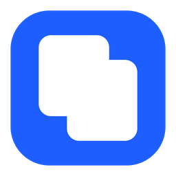
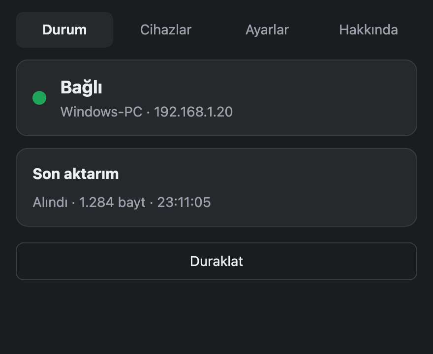
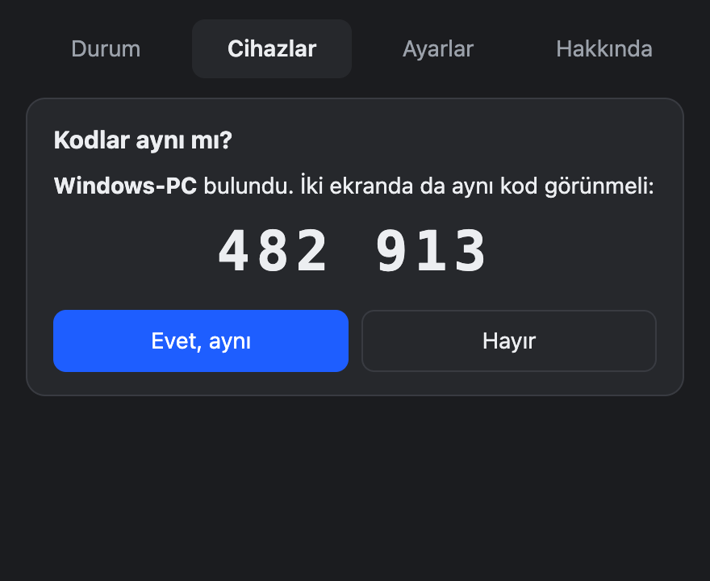

<div align="center">



# OpenContinuity

**Copy on your Mac, paste on your Windows PC — and back.**<br>
Mac'te kopyala, Windows'ta yapıştır. Tersi de.

[](https://github.com/behcetozcann/opencontinuity/releases/latest)

[](LICENSE.md)
[](https://github.com/behcetozcann/opencontinuity/actions/workflows/ci.yml)

[**İndir**](https://github.com/behcetozcann/opencontinuity/releases/latest) · [Nasıl çalışır](#nasıl-çalışır) · [Gizlilik](#gizlilik-ve-güvenlik) · [English](#english)

</div>

---

Apple'ın Universal Clipboard'u yalnız Apple cihazları arasında çalışır. OpenContinuity aynı rahatlığı **Mac ile Windows arasına** getirir: iki bilgisayarı bir kez eşleştirirsiniz, sonra her zamanki gibi `Cmd+C` / `Ctrl+V`. Bulut yok, hesap yok, ek tuş yok.

<p align="center">
  
  
</p>

## Öne çıkanlar

- **Sıfır alışkanlık değişikliği** — normal kopyala/yapıştır; uygulama menü çubuğunda / sistem tepsisinde sessizce çalışır.
- **Sadece yerel ağ** — veri hiçbir sunucuya gitmez; iki bilgisayar doğrudan konuşur.
- **Uçtan uca şifreli** — karşılıklı TLS 1.3, cihaza özel anahtarlar.
- **6 haneli kodla eşleştirme** — IP adresi girmeden, aynı ağdaki cihazı kendisi bulur.
- **Parolalar gönderilmez** — parola yöneticilerinin "gizli" işaretli kopyaları atlanır.
- **Kendiliğinden toparlanır** — Wi-Fi değişimi, uyku/uyanma, yeniden başlatma sonrası tekrar bağlanır.
- **Otomatik güncelleme** — yeni sürümler imzalı olarak uygulamanın içinden kurulur.
- **Türkçe ve emoji dostu** — Unicode metin bayt bayt aynı ulaşır.

## Kurulum

| | |
|---|---|
| **macOS** (13+, Apple Silicon ve Intel) | [Son sürümden](https://github.com/behcetozcann/opencontinuity/releases/latest) `.dmg` dosyasını indirin, uygulamayı Applications'a sürükleyin. İlk açılışta sağ tık → **Aç**. |
| **Windows** (10/11) | `-setup.exe` dosyasını indirip kurun. SmartScreen uyarısında **Ek bilgi → Yine de çalıştır**. |

Sonra iki bilgisayarda da uygulamayı açın, **Eşleştir**'e basın, iki ekrandaki kodun aynı olduğunu onaylayın. Bu kadar.

> Test sürümleri henüz kod imzalı değildir; bu yüzden ilk açılışta işletim sistemi uyarı gösterir.

## Nasıl çalışır

```text
 Mac                                         Windows
┌────────────────────┐   TLS 1.3, yerel ağ   ┌────────────────────┐
│ pano izleyici      │ ◄═══════════════════► │ pano izleyici      │
│ eş anahtarı        │                       │ eş anahtarı        │
└────────────────────┘                       └────────────────────┘
          ▲                                             ▲
          └────────── mDNS ile birbirini bulur ─────────┘
```

1. Bilgisayarlar aynı ağda mDNS/Bonjour ile birbirini bulur.
2. İlk eşleştirmede iki ekranda aynı 6 haneli kod görünür; bu kod TLS oturumuna bağlıdır, araya giren biri aynı kodu üretemez.
3. Sonrasında bir cihazda kopyaladığınız düz metin diğerinin panosuna yazılır. Döngü ve çakışma önleme, Lamport saatleriyle "son yerel kopya önceliklidir" kuralına göre çalışır.

Ayrıntı: [mimari](docs/architecture.md) · [protokol](docs/protocol.md) · [güvenlik modeli](docs/security-model.md)

## Gizlilik ve güvenlik

- Merkezi sunucu, hesap, telemetri **yoktur**.
- Pano içeriği hiçbir kayda yazılmaz; teşhis kaydında yalnız boyut ve hash öneki bulunur.
- Karşı cihaz kapalıyken kopyaladıklarınız biriktirilmez.
- Tek tıkla **Duraklat**: hassas bir şey kopyalayacaksanız paylaşımı geçici olarak durdurun.
- Kriptografi denetlenmiş kütüphanelerle (rustls, ring) yapılır.

Güvenlik açığı bildirimi için lütfen herkese açık issue yerine [GitHub güvenlik bildirimi](https://github.com/behcetozcann/opencontinuity/security/advisories/new) kullanın.

## Yol haritası

- [x] Mac ↔ Windows düz metin, eşleştirme, menü çubuğu / tepsi uygulaması, otomatik güncelleme
- [ ] Görsel (PNG) panosu
- [ ] Birden fazla cihaz
- [ ] Linux
- [ ] Mobil (Android / iOS paylaşım menüsü)

## Lisans ve ticari kullanım

OpenContinuity kaynak kodu açık, **ticari olmayan kullanım için ücretsizdir** ([PolyForm Noncommercial 1.0.0](LICENSE.md)):

- ✅ Kişisel kullanım, eğitim, araştırma, hobi projeleri, kâr amacı gütmeyen kuruluşlar
- ✅ Kodu incelemek, değiştirmek, ticari olmayan amaçla paylaşmak
- ❌ Şirket içinde ticari kullanım, ürüne gömme, yeniden satış, ücretli hizmet olarak sunma

**Ticari lisans** için [bir issue açın](https://github.com/behcetozcann/opencontinuity/issues/new?title=Ticari%20lisans%20talebi) ya da [GitHub profilimden](https://github.com/behcetozcann) ulaşın.

## Geliştirme

Rust (2024) + [Tauri 2](https://tauri.app).

```sh
cargo test --workspace
cargo clippy --workspace --all-targets -- -D warnings
cd apps/desktop/src-tauri && cargo tauri dev
```

| Dizin | |
|---|---|
| `crates/engine` | Senkron motoru: eşleştirme, bağlantı, pano döngüsü |
| `crates/{protocol,core,transport,pairing,discovery,clipboard}` | Protokol, durum makinesi, TLS, kimlik, mDNS, pano adaptörleri |
| `apps/desktop` | Masaüstü uygulaması (Tauri) |
| `apps/cli` | `oc` teşhis aracı |

Katkılar memnuniyetle karşılanır; büyük değişikliklerden önce lütfen bir issue açın.

---

## English

**OpenContinuity** brings Apple-style Universal Clipboard to **Mac ↔ Windows**. Pair two computers once with a 6-digit code, then just copy and paste as usual. Everything stays on your local network, end-to-end encrypted (mutual TLS 1.3), with no cloud, no account and no telemetry. Password-manager copies marked as concealed are never sent.

**Install:** grab the `.dmg` (macOS 13+) or `-setup.exe` (Windows 10/11) from the [latest release](https://github.com/behcetozcann/opencontinuity/releases/latest). Builds are not code-signed yet, so the OS will warn on first launch. The app updates itself.

**License:** source-available under [PolyForm Noncommercial 1.0.0](LICENSE.md) — free for personal and other noncommercial use. For commercial licensing, [open an issue](https://github.com/behcetozcann/opencontinuity/issues/new?title=Commercial%20license%20request) or contact [@behcetozcann](https://github.com/behcetozcann).
